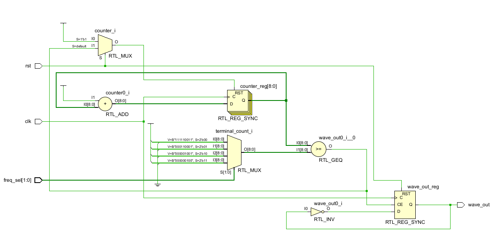
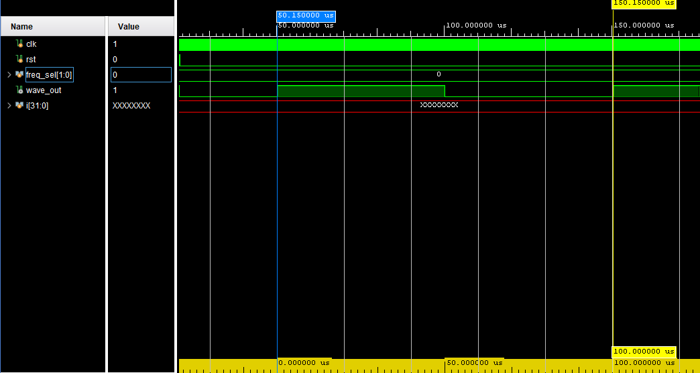
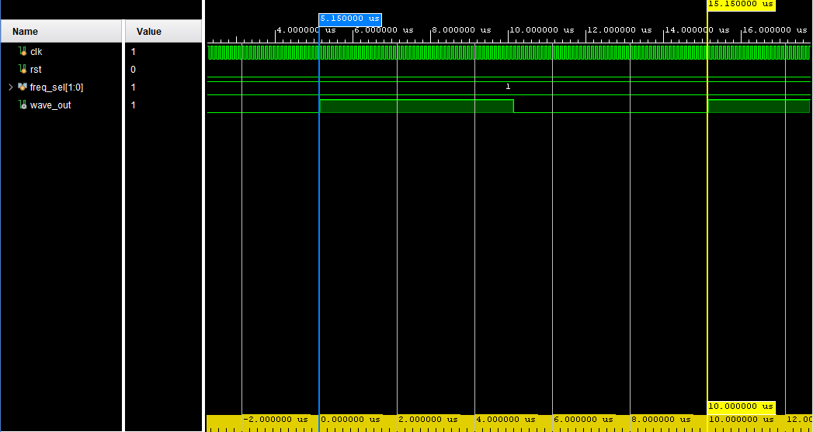
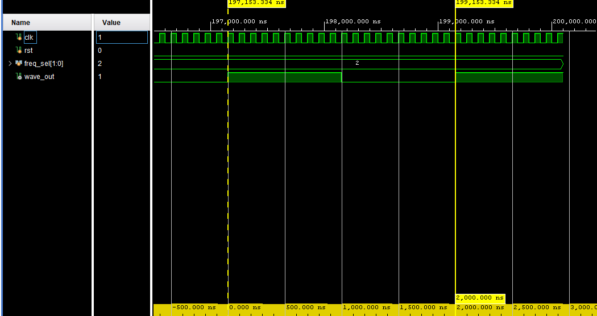
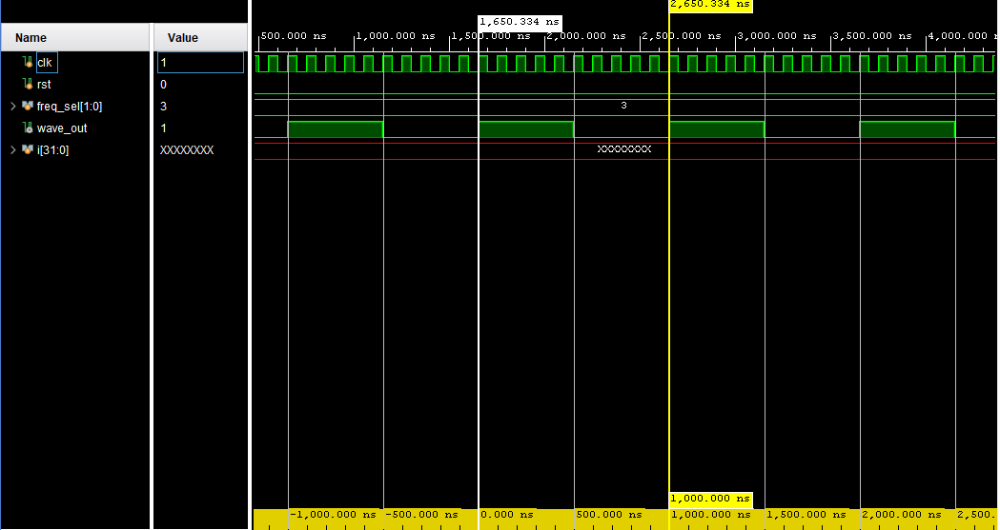

# Programmable Square-Wave Generator (Verilog HDL)

A synthesizable Verilog RTL project that generates a square wave with four selectable output frequencies. The design uses a counter, a 2-bit mode selector, and a self-checking testbench. It was developed and simulated with AMD Vivado/XSim; no physical FPGA board is required for RTL simulation.

## Highlights

- Verilog RTL for a programmable square-wave output
- Four frequency modes selected by `freq_sel[1:0]`
- Active-high synchronous reset
- Self-checking testbench measuring the output period and checking reset behavior
- Vivado project-generation Tcl script
- Saved waveform configurations and simulation screenshots

## Architecture

The `waveform_generator` module increments a counter on each rising edge of `clk`. The selected terminal count determines when the counter resets and `wave_out` toggles. Since the output toggles once per half-period, a complete output period contains two counter intervals.



## Frequency modes

The following values assume a **10 MHz input clock** (100 ns clock period).

| `freq_sel` | Terminal count | Counter interval | Expected output frequency | Expected output period |
|---|---:|---:|---:|---:|
| `2'b00` | 499 | 500 input clocks | 10 kHz | 100 µs (100,000 ns) |
| `2'b01` | 49 | 50 input clocks | 100 kHz | 10 µs (10,000 ns) |
| `2'b10` | 9 | 10 input clocks | 500 kHz | 2 µs (2,000 ns) |
| `2'b11` | 4 | 5 input clocks | 1 MHz | 1 µs (1,000 ns) |

The expected frequency is

\[
f_{out}=\frac{f_{clk}}{2(terminal\_count+1)}
\]

Frequencies scale linearly with the input clock. `freq_sel` is decoded combinationally; for deterministic operation, change modes while reset is asserted, as done by the testbench.

## Verification

The testbench in `sim/tb_wave_generator.v` performs these checks:

1. Asserts reset and checks that `wave_out` and the internal counter return to zero.
2. Runs all four selector settings.
3. Measures the time between consecutive rising edges of `wave_out`.
4. Compares each measured period with its expected value and prints `PASS` or `FAIL` messages.
5. Prints a final summary. A successful run ends with `RESULT: ALL TESTS PASSED`.

Expected periods for the 10 MHz test clock are **100,000 ns**, **10,000 ns**, **2,000 ns**, and **1,000 ns**, respectively. These are calculated expectations; run the testbench in your simulator to generate the actual pass/fail output for your current RTL.

### Simulation screenshots

The repository includes XSim waveform screenshots for the frequency modes. Use the self-checking testbench output as the primary verification result; screenshots are supporting visual evidence and do not alone prove that every test passed.

- `freq_sel = 2'b00`: expected 10 kHz — 
- `freq_sel = 2'b01`: expected 100 kHz — 
- `freq_sel = 2'b10`: expected 500 kHz — 
- `freq_sel = 2'b11`: expected 1 MHz — 

The first image's current filename is `1KHz.png`; the expected frequency from the RTL and 10 MHz clock is **10 kHz**. The `.wcfg` files save waveform-view settings; they are not test results by themselves.

## Repository layout

```text
verilog-waveform-generator/
├── src/
│   └── waveform_generator.v
├── sim/
│   └── tb_wave_generator.v
├── scripts/
│   └── create_project.tcl
├── waveforms/          # XSim waveform display configurations
├── docs/               # Schematic and waveform screenshots
├── .gitignore
├── LICENSE
└── README.md
```

## Run with AMD Vivado / XSim

1. Clone or open this repository in a local working directory.
2. Launch Vivado and open the **Tcl Console**.
3. From the repository root, run:

   ```tcl
   source scripts/create_project.tcl
   ```

4. In **Flow Navigator → Simulation**, select **Run Behavioral Simulation**.
5. Inspect the Tcl/console output for all four frequency checks and the final result line.

The supplied Tcl script targets the Kintex-7 part `xc7k70tfbv676-1`. To use another supported part, edit `PART` near the top of `scripts/create_project.tcl` before running it. The part selection is for project setup and does not imply that a physical board was used.

## Run with another Verilog simulator

Compile `src/waveform_generator.v` and `sim/tb_wave_generator.v` together with a Verilog-2001-compatible simulator. The testbench uses `$dumpfile` and `$dumpvars` to request a VCD file; VCD support depends on the simulator.

## Design limitations and engineering notes

- `rst` is an **active-high synchronous reset**, sampled on the rising edge of `clk`.
- This design generates a square wave only; it does not generate sine, triangle, or arbitrary sampled waveforms.
- The RTL/testbench demonstrate functional simulation. They do not replace timing analysis, implementation, or hardware validation.
- A real FPGA deployment also needs a suitable clock constraint and board-specific pin constraints.

## Synthesis snapshot

A previously supplied Vivado 2025.2 synthesis report for `xc7k70tfbv676-1` listed **9 Slice LUTs** and **10 Slice Registers**. These are synthesis-stage figures from that report, not post-implementation results or measured hardware performance. Re-run synthesis after RTL, target-part, or tool-version changes before using these figures as current results.

## License

Released under the MIT License. See [LICENSE](LICENSE).
